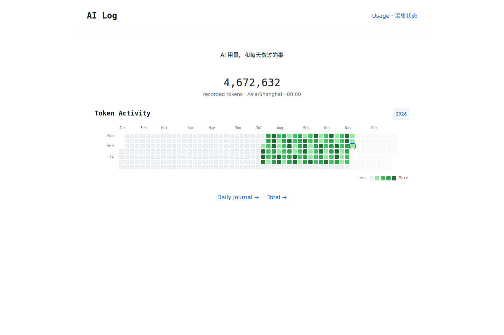

# AI Log

**每天用了多少 AI？这些 token 用来做了什么？**

AI Log 是一个本地优先、可自行部署的 AI 用量日志。它从已有 Agent 日志读取真实 token 记录，把多台设备的用量汇总成日历热力墙、每日日志和周期回顾。



- **用量统计**：按天、周、月、年和全部历史查看，按 Agent / 设备 / 模型拆分。
- **多设备采集**：本机、SSH、Windows WSL 和快照导入；设备离线时保留上次结果。
- **真实记录与去重**：处理累计计数、流式重复记录和迁移日志副本，缺失用量不按字数猜测。
- **可选工作回顾**：默认关闭。开启后记录任务意图、会话报告的结果和待办，长周期复用缓存摘要。
- **独立运行**：Node.js 24+，没有运行时 npm 依赖，不需要接入已有博客或日记系统。
- **可导出**：JSON 和 Markdown，便于与你自己的 Diary 结合。

## 快速开始

需要 Node.js **24 或更新版本**。当前项目发布在 GitHub，尚未发布到 npm Registry。

```sh
git clone https://github.com/ch-z-hc/ai-log.git
cd ai-log
npm install -g .
ai-log init
ai-log collect
ai-log serve
```

打开 **http://127.0.0.1:4317**。`collect` 和浏览网页均不调用模型。要定期采集，在另一个终端运行 `ai-log watch`；默认每 5 分钟采集一次。

不安装也能运行：`node bin/ai-log.cjs --help`。从仓库生成可安装包：`npm pack`，然后 `npm install -g ./ch-z-hc-ai-log-0.1.0.tgz`。

只想看看界面，可以使用**完全模拟的数据**：

```sh
ai-log demo --data-dir ./demo-data
ai-log serve --data-dir ./demo-data
```


## 支持的日志

| Agent / 数据源 | 支持范围 |
| --- | --- |
| Codex | sessions / archived_sessions，JSONL / Zstandard，逐次 usage 与旧累计计数 |
| Claude Code | projects JSONL，流式合并，缓存读写归入输入 |
| Pi / Oh My Pi | session JSONL |
| OpenCode | 本地 SQLite 中的 message / part |
| Zcode | SQLite `model_usage` |
| CC Switch | 历史 proxy request 记录，与原始 Claude 记录去重 |
| Qoder Work | 兼容 JSONL 中明确保存的 usage；没有记录时不估算 |

Python WSL 回退当前**只解析 Codex**，需要 Python 3.9+；压缩日志额外需要系统 `libzstd.so.1`。其它工具只显示发现状态。完整采集器使用 Node.js 24+。

这些是对本地日志格式的适配，不是服务商账单接口。服务商更改日志格式可能需要更新适配器。没有记录的调用无法还原，token 用量也不代表金额或订阅剩余额度。详细口径见 [数据与统计](docs/data.md)。

## 多设备配置

`ai-log init` 在 `~/.config/ai-log/config.json` 创建配置，数据默认放在 `~/.local/share/ai-log/`。Windows 中 `~` 指用户主目录。也可以用 `--config PATH`、`--data-dir PATH` 或 `AI_LOG_CONFIG` / `AI_LOG_DIR` 覆盖。

```json
{
  "timezone": "Asia/Shanghai",
  "captureText": false,
  "sources": [
    { "id": "local", "name": "This computer", "type": "local" },
    { "id": "laptop", "name": "Laptop", "type": "ssh", "host": "my-laptop" },
    { "id": "linux", "name": "Laptop WSL", "type": "wsl", "host": "my-laptop", "distro": "Ubuntu" }
  ],
  "review": { "enabled": false }
}
```

SSH 使用你已有的 SSH config、密钥和 known_hosts，不创建或复制凭据，需能够非交互登录。远端 Node 采集需要 `node` 已在 SSH 的 PATH 中。向远端标准输入发送只读扫描脚本，返回压缩的标准化快照；不向远端安装 npm 包。

WSL 类型省略 `host` 即在本机 Windows 执行，也可以添加 `user`。`home` 可覆盖扫描的账户主目录。其它配置见 [配置示例](examples/config.example.json)。

默认按 **Asia/Shanghai 自然日零点**汇总，周一是一周开始。时区可设置为 IANA 名称，例如 `UTC` 或 `America/New_York`；修改时区后需要重新采集所有来源，文件快照必须使用相同时区。

## 可选 Review

Review 需要同时开启对话摘录采集和模型生成：

```json
{
  "captureText": true,
  "review": {
    "enabled": true,
    "provider": "codex",
    "command": "codex",
    "model": "gpt-6.1-sol",
    "maxInputChars": 24000,
    "maxCallsPerRun": 5,
    "maxCallsPerDay": 20
  }
}
```

先运行 `ai-log collect` 采集摘录，再运行 `ai-log review`。Codex 模式使用你已安装并登录的 Codex CLI；不会申请 API key、自动登录或切换模型。需要当前 CLI 支持代码中使用的 exec / ephemeral / schema 选项。Windows 可把 `command` 指向 `codex.exe`；对于 npm 的 `.cmd` 启动器，使用 `command: "node"` 并在 `args` 中给出 CLI JavaScript 入口。也支持你自己的 JSON 命令提供器，见 [Review 机制](docs/reviews.md)。

- 日回顾：当天结束后生成；周 / 月 / 年：对应周期结束后生成。
- 相同材料复用缓存，回补材料导致的重算每个周期每天最多一次。
- 周 / 月复用日摘要；年优先复用月摘要；Total 优先复用年 / 月摘要，必要时退回日摘要，**不直接重读原始长历史**。
- **Total 只手动生成**：`ai-log review --period total`。仅覆盖已结束日期，等待这些日期的子摘要就绪。
- 超过输入字符上限就暂停该项，不截断材料冒充完整回顾；有单次运行及每日调用次数限制。
- `ai-log watch` 只在显式开启 Review 后自动生成已结束周期。网页始终只读，不触发模型。

Review 会消耗你配置的模型账户额度。字符上限是输入长度约束，不是精确 token 预算。返回的 token usage 保存于独立账本，也会计入总用量；未返回的失败调用无法准确计费。所有测试和演示均不请求真实模型。

## 隐私与部署边界

默认不保存对话摘录，也不调用模型。开启 `captureText` 后会保存少量用户 / 助手文字，开启 Review 后会将相关材料发送给你配置的模型服务。凭据过滤只能降低意外泄漏风险，**不保证消除所有敏感内容**。关闭开关不会自动删除此前已保存的摘录或回顾，保留策略由你管理。

Web 默认且仅监听 `127.0.0.1`，没有内置多用户认证。若需从其它设备访问，可使用 SSH 本地端口转发；若自行放在反向代理后，必须配置认证和合适的 Host 转发，不能直接公开个人日志。仓库和 npm 包仅含代码、文档与模拟测试，不含账户配置、真实日志或 SSH 密钥。不要把自己的数据目录提交到 Git。

0.1 使用原子 JSON / gzip 文件存储，延续已有采集器的格式，方便检查和备份；没有为了首版额外引入中心数据库。

## 开发

```sh
npm test
npm pack --dry-run
```

测试使用临时目录和合成日志，覆盖计数去重、缓存、隐私开关、Python 回退、离线来源、日历边界、网页和摘要依赖；不触碰真实历史或调用真实模型。CI 覆盖 Linux / Windows / macOS 的 Node.js 24，实际结果以 Actions 为准。

后续方向：更多 Agent 适配、Diary 集成、更细的增量摘要与存储优化。项目维护规则见 [AGENTS.md](AGENTS.md)。

MIT License.
