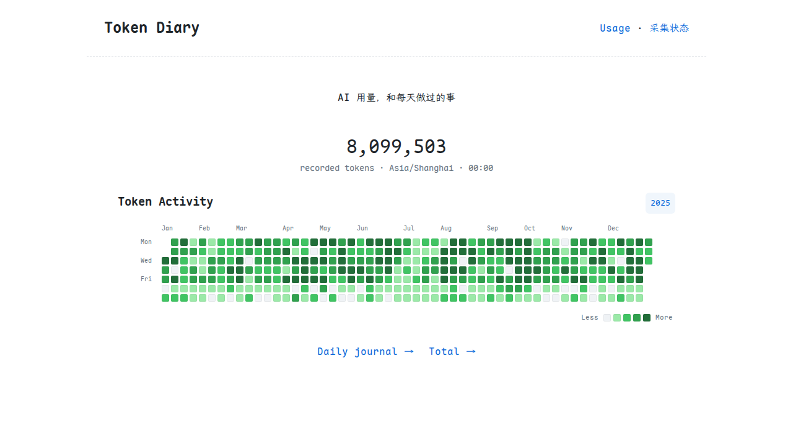
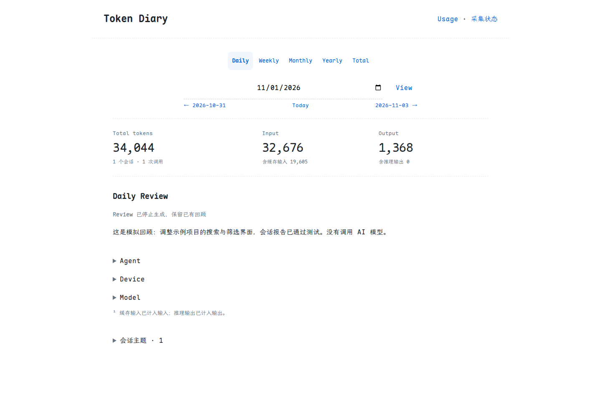

# Token-Diary

记录你与 AI 一起做过的事。

Token-Diary 把分散在不同工具和设备上的 AI 使用记录汇集起来：看见每天的用量，也留下任务、进展和回顾，让一次次对话成为可以翻阅的日志。

## 看见使用的节奏

通过年度热力墙查看每天的 token 用量，点击日期进入当天的记录。你可以按日、周、月、年查看，也可以浏览全部历史，再按工具、设备或模型拆分用量。

多台电脑的记录可以汇总在一起。设备暂时离线时保留上次结果，重新连接后补齐记录；能够识别的重复记录会合并统计。

## 留下做过的事

开启 Review 后，Token-Diary 会把会话中的任务意图、报告的结果和待办整理成简短回顾，帮助你找到当时在做什么、哪些工作还在继续。

| 回顾 | 更新方式 |
| --- | --- |
| 每日 | 当天结束后生成 |
| 每周 | 一周结束后生成，周一至周日为一周 |
| 每月 | 当月结束后生成 |
| 每年 | 当年结束后生成 |
| Total | 手动更新全部已结束日期的回顾 |

已有回顾会复用。长周期回顾依据已保存的小周期摘要整理，材料没有变化时不重复生成。浏览页面和采集用量不调用模型；Review 默认关闭，开启后会使用你配置的模型账户额度。

## 汇集不同工具的记录

目前支持 Codex、Claude Code、Pi、Oh My Pi、OpenCode、Zcode、CC Switch 历史用量，以及 Qoder Work 中明确保存的用量记录。

只统计能够读取到的实际用量，不根据文字长度猜测消耗。缺失记录无法还原，token 用量也不等于金额或订阅剩余额度。ChatGPT 网页 / App 的聊天可以通过官方导出文件导入，用于消息统计和每日回顾；没有实际 token 记录时显示未知，不混入实测用量。新聊天需要再次导入。

## 从一台电脑开始

按照[使用指南](docs/guide.md)运行后，打开本地面板即可查看记录；也可以先用演示数据体验界面，再添加自己的设备。

开启后台采集后，用量约每 5 分钟更新一次。日志可以导出，方便保存或与你自己的日记结合。

- [安装、演示与多设备配置](docs/guide.md)
- [统计口径与数据导出](docs/data.md)
- [Review 设置与用量控制](docs/reviews.md)

## 数据由你保管

记录保存在自己的设备上。默认只采集用量，不保存对话摘录；开启摘录和 Review 后，相关文字才会用于生成回顾。文字过滤不能保证清除所有敏感内容，关闭开关也不会自动删除此前保存的材料。

面板默认仅供本机访问。仓库中的截图和示例均使用模拟数据。

[MIT License](LICENSE)
